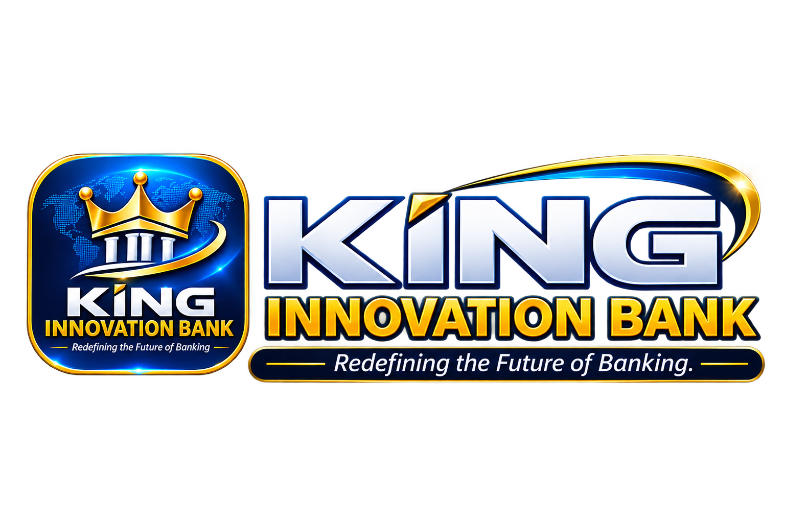

<p align="center">
  
</p>
---
KING INNOVATION BANK is a digital banking design project built around a simple idea: banking should be easier to access, easier to understand, and more convenient to use.

The project explores how a modern banking platform can bring essential financial services together through a clean interface, intuitive navigation, and carefully connected user journeys.

Rather than designing individual screens in isolation, the focus is on creating a consistent banking experience, from signing in and managing transactions to making payments and monitoring banking activities.

## About the Project

The project is designed in Figma and brings together customer-facing banking interfaces and administrative functionalities within one design ecosystem.

Particular attention is given to the way users interact with the platform, how information is presented, and how different banking operations connect with one another.

The goal is to make everyday banking activities feel straightforward while maintaining a consistent and professional visual experience.

## Design & Features

The Figma workspace is organized into three main sections.

### 00 – Cover

The visual introduction to KING INNOVATION BANK, establishing the project's identity and overall design direction.

### 01 – Design Tokens

The foundational design elements used throughout the project. This section provides a consistent visual language and helps maintain uniformity across different screens and components.

### 02 – UI Screens & Flows

This section contains the main interfaces and banking workflows developed for the platform.

**1. Banking Dashboard**

The main interface, bringing important banking information and frequently used services together in one place.

**2. Secure Login**

An account access interface designed with simplicity, clarity, and security-conscious design principles in mind.

**3. Recipient & Source**

A transaction interface that allows users to identify the recipient and select the appropriate source of funds.

**4. Amount & Fee**

A dedicated step for entering transaction amounts and reviewing applicable fees before proceeding.

**5. Success Receipt**

A transaction confirmation screen that presents the outcome of a completed payment or transfer in a clear and understandable way.

**6. Bill Payment Hub**

A centralized interface for accessing bill payment services and organizing different payment activities.

**7. Administration Dashboard**

An administrative interface designed to bring banking management information and operational activities into a structured workspace.

**8. Transaction Monitoring**

An interface for reviewing and monitoring transaction activities, with an emphasis on clarity and accessibility of information.

## Design Approach

The design follows a user-centered approach, with an emphasis on:

- Keeping banking operations simple and intuitive.
- Maintaining consistency across screens and components.
- Creating clear and logical transaction flows.
- Presenting financial information in an understandable way.
- Establishing a reusable design foundation.
- Balancing visual appeal with practical usability.

Each interface is considered part of a larger banking experience rather than a standalone design.

## Tools & Technologies

- **Figma:** Interface design and prototyping.
- **Design Systems:** Reusable design elements and visual consistency.
- **GitHub:** Project documentation, asset organization, and version management.

## Project Organization

The project is structured to keep the design files, exported screens, and supporting documentation organized as the work progresses.

```text
KING-INNOVATION-BANK/
│
├── README.md
│
├── figma/
│   └── figma-project-link.md
│
├── screenshots/
│   ├── dashboard/
│   ├── authentication/
│   ├── transactions/
│   ├── payments/
│   └── administration/
│
├── design-assets/
│   ├── design-tokens/
│   └── components/
│
└── documentation/
    ├── project-overview.md
    ├── user-flows.md
    └── design-guidelines.md
```

## Project Vision

KING INNOVATION BANK represents an exploration of what a more connected and user-friendly banking experience could look like.

The broader vision is to bring banking services, transaction management, and administrative operations together in a well-structured digital environment.

The project will continue to evolve as new ideas, design improvements, and additional functionalities are explored.

## Project Status

**Current stage:** UI/UX Design and Prototyping.

This repository serves as the central place for documenting the project, showcasing its design, and tracking its continued development.

## Figma Design

The complete design, including the individual screens and user flows, can be explored through the Figma project below.

**Figma Project:** [View KING INNOVATION BANK](https://www.figma.com/design/kh29w9S0ZQxrQBKVQQ02jz/KING-INNOVATION-BANK?node-id=48-134&t=sMulyWTNPQzMLCgS-1)

---

**KING INNOVATION BANK**

*Redefining the Future of Banking.*
